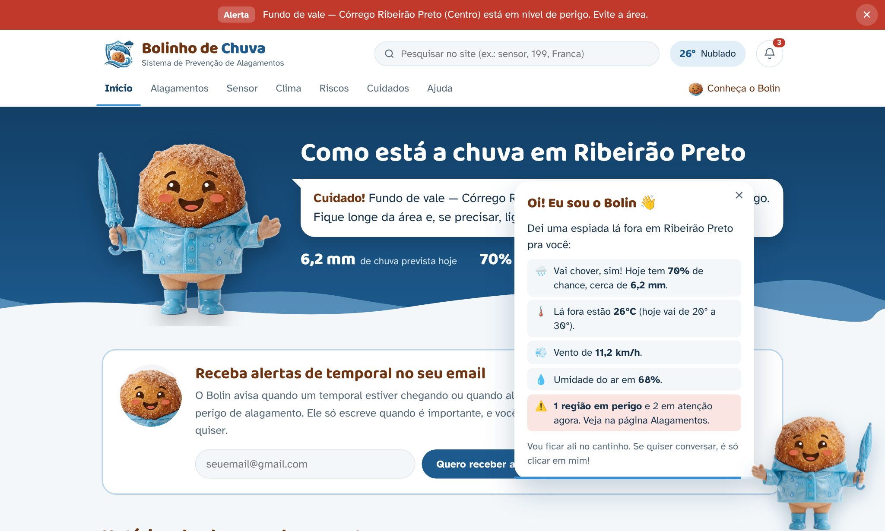
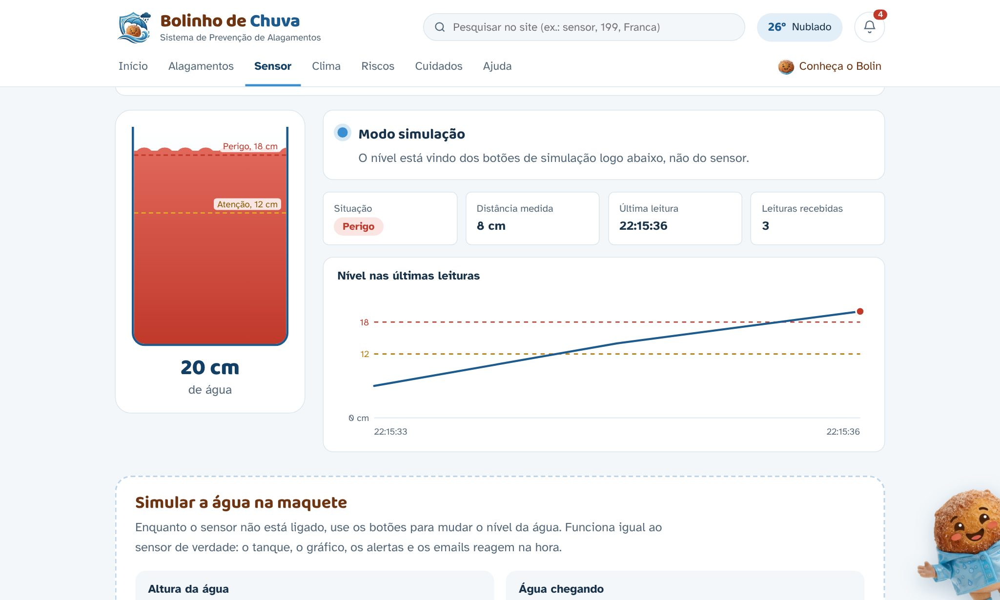

# Bolinho de Chuva

Sistema de prevenção de alagamentos para Ribeirão Preto e Franca (SP), feito no Projeto
Integrador Interdisciplinar (PINT2).

A ideia é juntar num lugar só o que a gente precisa saber quando a chuva aperta: como está
o tempo agora, quais regiões da cidade costumam alagar, as notícias de chuva da região e o
nível da água medido por um sensor numa maquete. Quando alguma coisa sai do normal, o site
avisa na tela e por email.

Quem acompanha o usuário pelo site é o **Bolin**, um bolinho de chuva de 5 anos, de capa
azul e galochas, que é o mascote do projeto.

**Site publicado:** https://bolinho-de-chuva.onrender.com
(fica no plano gratuito do Render, então se ninguém abriu o site nos últimos 15 minutos a
primeira abertura demora cerca de 1 minuto)



---

## O que tem no site

| Página | O que mostra |
|---|---|
| **Início** | Resumo do dia, cadastro de email para receber alertas e notícias de chuva separadas por cidade (Ribeirão Preto, Franca e Brasil) |
| **Alagamentos** | Mapa das regiões monitoradas, lista com busca e filtro por situação e o histórico de alertas |
| **Sensor** | Nível da água da maquete em tempo real, gráfico das últimas leituras, conexão com o Arduino pelo cabo USB e botões para simular a água |
| **Clima** | Chuva prevista, temperatura, vento, umidade e previsão dos próximos dias |
| **Riscos** | Por que é perigoso entrar na água de um alagamento |
| **Cuidados** | O que fazer antes, durante e depois de um alagamento |
| **Ajuda** | Telefones de emergência: Defesa Civil 199, Bombeiros 193, SAMU 192 |
| **Conheça o Bolin** | A história do mascote e dicas |

Em todas as páginas tem:

- uma **barra de pesquisa** no topo, que acha páginas, telefones e cuidados enquanto você digita;
- o **sininho** com as regiões em alerta naquele momento;
- uma **faixa vermelha** quando alguma região entra em perigo (dá para fechar no X);
- o **Bolin no canto da tela**: na primeira página que a pessoa abre ele conta como está o
  tempo, e depois dá para clicar nele e escolher perguntas prontas.

Cada região fica em uma de três situações: **tranquilo**, **atenção** ou **perigo**.

---

## Como funciona

O projeto é um programa só, escrito em **C#** (ASP.NET Core, .NET 8). Ele faz duas coisas:
entrega as páginas do site e responde a API, que fica em `/api`.

O site é **HTML, CSS e JavaScript**. O **Vue.js** (Options API) foi usado nas três partes que
precisam se atualizar sozinhas, sem recarregar a página:

- o painel do sensor (`frontend/js/sensor.js`);
- a lista de regiões e o histórico de alertas (`frontend/js/alagamentos.js`);
- a barra de pesquisa (`frontend/js/busca.js`).

Serviços de fora que o sistema usa:

- **Open-Meteo** — clima de Ribeirão Preto (gratuito e sem chave);
- **feeds RSS** do Google Notícias, do G1 e da Agência Brasil — o sistema filtra e deixa passar
  só as notícias que falam de chuva, temporal ou alagamento;
- **Google Apps Script** — envia os emails pela conta do projeto e guarda os inscritos numa
  planilha do Google Sheets;
- **OpenStreetMap + Leaflet** — o mapa da página Alagamentos.

### Quando os emails são enviados

Um serviço roda em segundo plano (`MonitorDeAlertasService`) olhando as regiões e o clima:

| Alerta | Quando | Limite |
|---|---|---|
| Alagamento | uma região entra em perigo | 1 a cada 30 minutos por região |
| Chuva | começa a chover de verdade em Ribeirão Preto | 1 a cada 6 horas |
| Temporal | previsão de trovoada ou chuva forte | 1 por dia |

Quem se cadastra na página Início recebe na hora um email de boas-vindas do Bolin.

---

## O sensor



A maquete tem um sensor ultrassônico **HC-SR04** preso acima da água, apontando para baixo,
ligado a um **Arduino**. O sensor mede a distância até a superfície da água e o Arduino
escreve essa distância no cabo USB duas vezes por segundo:

```
Distancia: 15.2 cm
```

Ligação do sensor no Arduino: **VCC → 5V**, **GND → GND**, **Trig → pino 2**, **Echo → pino 3**.
O código está em [`sensor/arduino/sensor_breno/sensor_breno.ino`](sensor/arduino/sensor_breno/sensor_breno.ino).

Com o Arduino ligado no computador, a página **Sensor** lê essas linhas pela **Web Serial**
do navegador (`frontend/js/sensor-usb.js`) e, a cada segundo, manda a distância para a API:

```
POST /api/sensor-leitura
{ "zonaId": "maquete-demo", "distanciaCm": 15.2, "alturaInstalacaoM": 0.25 }
```

A API calcula **nível da água = altura do sensor − distância medida**. Na maquete, a região
entra em **atenção a partir de 12 cm** de água e em **perigo a partir de 18 cm**. Esses limites
ficam em `backend/Data/ZonasIniciais.cs`, na zona `maquete-demo`.

### Ligando o sensor

1. Grave o código no Arduino pelo Arduino IDE.
2. Ligue o Arduino no computador pelo cabo USB e **feche o Monitor Serial** do Arduino IDE
   (enquanto ele estiver aberto, a porta fica presa).
3. Abra o site no **Google Chrome** ou no **Microsoft Edge** (o Firefox não tem Web Serial) e
   vá na página **Sensor**.
4. Clique em **Conectar sensor** e escolha a porta do Arduino.
5. Com a maquete **vazia**, clique em **"Usar a distância de agora"**. Isso grava a altura do
   sensor até o fundo, e a partir daí a água começa do zero.

Se a placa não aparecer na lista, o Windows provavelmente está sem o driver do chip USB dela.
No Gerenciador de Dispositivos ela aparece em "Outros dispositivos" com um triângulo amarelo.
Placas com chip **FT232R** usam o [driver VCP da FTDI](https://ftdichip.com/drivers/vcp-drivers/);
placas com chip **CH340** usam o driver da WCH.

### Sem o sensor

Na mesma página tem a parte **"Simular a água na maquete"**: botões para subir e descer a
água, atalhos (Seca, Normal, Atenção, Perigo) e uma chuva que faz a água subir sozinha a cada
2 segundos. A simulação passa pelo mesmo cálculo da leitura do sensor, então o tanque, o
gráfico, a faixa vermelha e os emails funcionam igual.

Também tem um código para **ESP32**, que manda a leitura direto pela Wi-Fi, sem precisar de
computador: [`sensor/esp32/bolinho_sensor`](sensor/esp32/bolinho_sensor/bolinho_sensor.ino).
A montagem está explicada em [`sensor/esp32/MAQUETE.md`](sensor/esp32/MAQUETE.md).

---

## Rodando no computador

Precisa do [Node.js](https://nodejs.org) 18 ou mais novo. Na pasta do projeto:

```
npm install
npm start
```

O `npm install` só precisa ser rodado na primeira vez; se o computador não tiver o .NET 8, ele
baixa sozinho para dentro da pasta do projeto. O `npm start` liga o sistema e abre o navegador
em **http://localhost:5080**. Para desligar, **Ctrl + C** no terminal.

| Comando | O que faz |
|---|---|
| `npm start` | Liga o sistema em http://localhost:5080 |
| `npm run rede` | Igual, mas aceitando conexões de outros aparelhos da rede (para o ESP32) |
| `npm run simulador` | Programa que finge ser o sensor (rodar em outro terminal) |
| `npm run teste-email` | Testa o envio de emails |
| `npm run teste-temporal` | Manda um alerta de temporal de teste |
| `npm run teste-alagamento` | Manda um alerta de alagamento de teste |

### Configurando os emails

Os emails saem pela conta do projeto através de um script do Google Apps Script. Com o sistema
ligado, abra **http://localhost:5080/configuracao.html** e siga os passos da página: ela mostra
o código para colar no Google, o lugar onde colar o link e botões para testar cada tipo de alerta.

O link e a chave do Google ficam em `backend/appsettings.Local.json`, que **não vai para o
GitHub** (está no `.gitignore`). Enquanto o Google não estiver conectado, os emails não são
enviados: ficam salvos em `backend/emails-de-teste/` para dar para ver como ficaram.

A página de configuração só abre no próprio computador que está rodando o sistema; no site
publicado ela fica desligada.

---

## API

| Rota | O que faz | Arquivo |
|---|---|---|
| `GET /api` | Lista todas as rotas | `Program.cs` |
| `GET /api/status` | Diz se o sistema está no ar | `StatusController.cs` |
| `GET /api/clima` | Clima de agora e dos próximos dias | `ClimaController.cs` |
| `GET /api/noticias` | Notícias de chuva e alagamento, por cidade | `NoticiasController.cs` |
| `GET /api/enchentes` | Situação de cada região | `EnchentesController.cs` |
| `GET /api/alertas` | Histórico de alertas | `AlertasController.cs` |
| `GET /api/contatos` | Telefones de emergência | `ContatosController.cs` |
| `POST /api/sensor-leitura` | Recebe a distância medida pelo sensor | `SensorController.cs` |
| `GET /api/sensor/status` | Última leitura e histórico do sensor | `SensorController.cs` |
| `POST /api/simulacao/maquete` | Simulação do nível da água | `SimulacaoController.cs` |
| `POST /api/emails/inscrever` | Cadastra um email e manda as boas-vindas | `EmailsController.cs` |
| `GET /api/emails/cancelar` | Cancela o recebimento de alertas | `EmailsController.cs` |
| `/api/config/...` | Configuração dos emails (só no computador local) | `ConfigController.cs` |

Os arquivos ficam em `backend/Controllers/`. Para ver a API funcionando, é só abrir
`/api` ou `/api/sensor/status` no navegador.

---

## Onde está cada coisa

Cada página tem um HTML, um CSS e um JS com o mesmo nome (a página inicial é
`index.html` + `inicio.css` + `inicio.js`).

| Procurando… | Arquivo |
|---|---|
| Uma página (ex.: Sensor) | `frontend/sensor.html`, `frontend/css/sensor.css`, `frontend/js/sensor.js` |
| Leitura do Arduino pelo cabo USB | `frontend/js/sensor-usb.js` |
| Cabeçalho, faixa vermelha e sininho | `frontend/js/comum.js`, `frontend/css/comum.css` |
| Barra de pesquisa | `frontend/js/busca.js` |
| O Bolin do canto da tela | `frontend/js/bolin-assistente.js` |
| Início do programa em C# | `backend/Program.cs` |
| Busca do clima | `backend/Services/Clima/ClimaService.cs` |
| Filtro das notícias | `backend/Services/Noticias/NoticiasService.cs` |
| Cálculo do nível do sensor | `backend/Services/Regioes/ZonasService.cs` |
| Quando os alertas saem | `backend/Services/Alertas/MonitorDeAlertasService.cs` |
| Texto e envio dos emails | `backend/Services/Email/` |
| Regiões e telefones | `backend/Data/ZonasIniciais.cs`, `backend/Data/ContatosData.cs` |

```
bolinho-de-chuva/
├── frontend/          o site: uma página .html por aba, e as pastas css/, js/ e img/
├── backend/           o programa em C#
│   ├── Controllers/   as rotas da API
│   ├── Services/      clima, notícias, regiões e sensor, alertas, emails
│   ├── Models/        o formato de cada dado
│   ├── Data/          regiões e telefones de emergência
│   └── Recursos/      imagens dos emails e o script do Google
├── sensor/            código do Arduino, do ESP32 e o simulador do sensor
├── scripts/           o que cada comando npm faz
├── docs/              imagens deste README
└── Dockerfile, render.yaml   publicação no Render
```

---

## Publicação

O site está no **Render**, no plano gratuito. O Render monta o sistema a partir deste
repositório usando o `Dockerfile` e o `render.yaml`, e publica sozinho de novo a cada
alteração no `main` (leva uns 5 minutos).

O link e a chave do Google ficam nas variáveis de ambiente do serviço no Render:
`Google__UrlScript` e `Google__Chave`.

---

## Problemas comuns

- **Faixa amarela "Não consegui falar com o sistema"**: o programa em C# não está ligado. Rode `npm start`.
- **"A porta 5080 já está sendo usada"**: o sistema já está ligado em outro terminal.
- **Clima "sem atualização"**: a Open-Meteo não respondeu; o site mostra o último dado que recebeu.
- **Emails não chegam**: abra `localhost:5080/configuracao.html` e veja o que está marcado com ✘.
- **"Conectar sensor" não acha o Arduino**: confira o driver do chip USB da placa (veja [O sensor](#o-sensor)).
- **Sensor conectado, mas sem leitura**: feche o Monitor Serial do Arduino IDE e confira se o código está gravado na placa.

---

## Equipe

- **Matheus** — site, API e integração
- **Breno** — sensor e maquete

PINT2 · Ribeirão Preto, 2026
